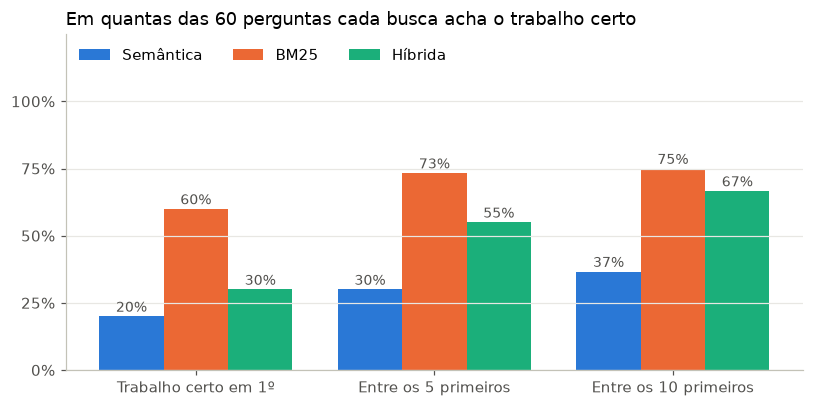

# Busca com IA nas teses de Computação do Brasil (RAG)

Faça uma pergunta em português sobre a pesquisa brasileira em Computação e receba uma resposta
escrita a partir das teses e dissertações reais, **com a citação de cada trabalho usado**. Se os
documentos encontrados não respondem à pergunta, o sistema diz isso em vez de inventar.

A base são os resumos de 23 mil teses e dissertações de Computação (2010–2024) do **Catálogo de
Teses e Dissertações da CAPES**, já tratados no projeto
[Evolução temática da pós-graduação em Computação](https://github.com/LetiBomfim/TAC_Pesquisa_temas_computacao).

## Backlog/Roadmap

- [X] Estrutura do repositório
- [X] Índice de busca semântica
- [X] Busca híbrida (semântica + BM25) e avaliação da recuperação
- [X] Geração de respostas com citações verificadas
- [X] Avaliação das respostas
- [X] App de perguntas e respostas

## Como rodar

Requer Python 3.10 ou superior.

```bash
python -m venv .venv
source .venv/bin/activate         # Para Windows é: .venv\Scripts\activate
pip install -r requirements.txt
cp .env.example .env              # e cole sua chave do Gemini no .env
```

A chave do Gemini é gratuita e pode ser criada no
[Google AI Studio](https://aistudio.google.com/apikey). O `.env` não é versionado.

### 1. Trazer os dados

A base de teses (`data/teses_computacao_2010_2024.csv.gz`) já vem no repositório. Os embeddings
dos resumos foram calculados no projeto de
[evolução temática](https://github.com/LetiBomfim/TAC_Pesquisa_temas_computacao). Se você tem
aquele projeto, copie o arquivo para não recalcular:

```bash
cp ../TAC_Pesquisa_temas_computacao/data/processed/embeddings.npz data/
```

### 2. Montar o índice

```bash
python src/indice.py
python src/indice.py --testar "redes neurais para diagnóstico de câncer"
```

### 3. Buscar

```bash
python src/busca.py "redes neurais para diagnóstico de câncer"                 # híbrida
python src/busca.py "redes neurais para diagnóstico de câncer" --modo bm25
python src/busca.py "redes neurais para diagnóstico de câncer" --modo semantica
```

### 4. Avaliar a busca

```bash
python src/gerar_perguntas.py   
```

Depois rode o notebook [`notebooks/01_avaliacao_busca.ipynb`](notebooks/01_avaliacao_busca.ipynb).

### 5. Perguntar

```bash
python src/responder.py "Que pesquisas usam aprendizado de máquina para prever evasão escolar?"
```

Cada pergunta usa 1 chamada ao Gemini. As respostas ficam salvas em `data/respostas.jsonl`.

### 6. Abrir o app

```bash
pip install -r app/requirements.txt
streamlit run app/app.py
```

## Como funciona

### Índice de busca semântica

[`src/indice.py`](src/indice.py)

Um **embedding** é um vetor de números que representa o sentido de um texto: textos sobre o mesmo
assunto ficam com vetores próximos. Para buscar, a pergunta também vira um vetor, e os resumos mais
próximos dela são os mais relevantes.

Os vetores dos 23.007 resumos já tinham sido calculados no projeto de evolução temática, com o
modelo multilíngue `paraphrase-multilingual-MiniLM-L12-v2`. Calcular de novo levaria de 15 a 40
minutos em CPU, então o script só os prepara para a busca:

- **confere** se cada vetor aponta para um trabalho da base e se todos têm tamanho 1;
- **reduz o tamanho pela metade**, de `float32` para `float16`, o que muda a similaridade só na
  terceira casa decimal. O índice (`data/indice.npz`) fica com 16 MB, pequeno o bastante para ir
  para o GitHub e para o app publicado;
- se o arquivo de embeddings não existir, **gera os vetores** com o mesmo modelo.

A pergunta precisa ser transformada pelo **mesmo modelo** que transformou os resumos, senão os
vetores não são comparáveis. Como todos os vetores têm tamanho 1, a proximidade entre dois deles é
o produto escalar, a **similaridade de cosseno**: perto de 1, mesmo assunto; perto de 0, nada a ver.

### Busca: semântica, BM25 e híbrida

[`src/busca.py`](src/busca.py)

A classe `Buscador` carrega o índice uma vez e busca de três formas:

- **Semântica:** compara o vetor da pergunta com o de cada resumo. Entende sinônimos e paráfrases,
  mas resume o texto num "sentido geral" e pode perder termos específicos. Além disso, o modelo lê
  só o começo de cada resumo (cerca de 100 palavras).
- **BM25:** a busca clássica por palavras, usada por buscadores há décadas. Dá pontos aos
  documentos que contêm as palavras da pergunta, e mais pontos às palavras raras. Considera o
  título, as palavras-chave e o resumo inteiro. Antes, o texto passa a minúsculas, perde os
  acentos ("diagnóstico" e "diagnostico" viram a mesma palavra) e perde as palavras muito comuns
  ("de", "para", "trabalho"). Acha termos exatos, mas não entende sinônimos.
- **Híbrida:** junta as duas listas pela *Reciprocal Rank Fusion* (RRF). Cada documento ganha
  1 / (60 + posição) em cada lista, e os pontos são somados: quem aparece bem nas duas sobe. Como
  usa só as posições, não importa que as notas das duas buscas tenham escalas diferentes.

O primeiro teste mostrou por que vale combinar as duas. Para "redes neurais para diagnóstico de
câncer":

| Busca | O que trouxe nos 5 primeiros |
|---|---|
| Semântica | Só trabalhos sobre redes neurais em geral; nenhum sobre câncer |
| Híbrida | Os 5 sobre câncer: carcinoma de mama, tumores orais, segmentação de núcleos celulares, subclasses de câncer e pólipos |

### Geração de respostas com citações

[`src/responder.py`](src/responder.py)

Para cada pergunta, o sistema busca os 5 resumos mais relevantes (com o BM25, a melhor busca na
avaliação), numera cada um de [1] a [5] e os envia ao Gemini com instruções:

- responder **só com base nos documentos**, sem conhecimento próprio e sem inventar trabalhos;
- indicar, depois de cada afirmação, o **número do documento** de onde ela veio;
- se nenhum documento ajuda, **dizer que não sabe** em vez de improvisar.

A resposta volta em JSON validado por um esquema (Pydantic) com três campos: `suficiente` (se os
documentos permitem responder), `resposta` e `citacoes`. O campo `suficiente` vem primeiro de
propósito: o modelo decide se há base para responder antes de escrever a resposta.

Depois, **as citações são conferidas no código**. O LLM pode citar um [7] quando recebeu só 5
documentos, ou escrever uma resposta sem nenhuma citação. As citações inválidas são retiradas do
texto e registradas, e as respostas sem citação são marcadas. Toda resposta fica salva em
`data/respostas.jsonl`, com os documentos usados, para a avaliação.

### App

[`app/app.py`](app/app.py)

Um app em Streamlit: a pessoa escreve a pergunta (ou clica num exemplo), lê a resposta com as
citações e abre o resumo de cada trabalho encontrado, com 📌 nos que foram citados. Algumas
decisões para ele funcionar no plano gratuito, tanto do Streamlit Cloud quanto do Gemini:

- **Sem o modelo de embeddings:** o app usa o BM25, a melhor busca na avaliação. O `Buscador` só
  carrega o modelo na primeira busca semântica, então o app não precisa instalar o `torch`,
  pesado demais para o servidor gratuito. Por isso o app tem um `requirements.txt` próprio, mais leve.
- **Índice carregado uma vez** (`st.cache_resource`) e compartilhado por todos os visitantes.
- **Respostas em cache:** a mesma pergunta feita duas vezes não gasta outra chamada.
- **Limite de 5 perguntas por visita**, para um visitante não esgotar a cota do dia.
- **Se o Gemini falhar** (cota esgotada, servidor ocupado), o app tenta 2 vezes e depois mostra
  os trabalhos que a busca encontrou, em vez de uma tela de erro.

### Perguntas de teste

[`src/gerar_perguntas.py`](src/gerar_perguntas.py)

Para saber se uma busca é boa, são necessárias perguntas cuja resposta certa já é conhecida. O
script sorteia 60 trabalhos (4 por ano, de forma reprodutível) e pede ao Gemini a pergunta que
alguém faria a um buscador e que cada trabalho responde. Na avaliação, cada busca é testada: o
trabalho que originou a pergunta aparece entre os primeiros resultados?

O LLM é instruído a **não copiar o título** e a usar as próprias palavras. Sem isso, o BM25 levaria
vantagem injusta, porque bastaria repetir os termos do título. Cada chamada leva 10 trabalhos
(6 chamadas no total), e as perguntas ficam salvas em `data/perguntas_avaliacao.jsonl`.

### Cliente do Gemini

[`src/llm.py`](src/llm.py)

As funções comuns para chamar o Gemini, reaproveitadas do projeto de evolução temática:

- **saída em JSON validada:** o esquema da resposta (um modelo Pydantic) é enviado ao Gemini, e a
  resposta é validada de novo ao chegar;
- **`temperature=0`**, para respostas o mais estáveis possível;
- **novas tentativas** com espera crescente quando a API recusa (limite de uso, servidor
  sobrecarregado) ou responde fora do formato, e um **limite de tempo** por chamada;
- **cache em JSONL:** cada resposta é salva assim que chega. Se o script parar no meio, basta
  rodar de novo que ele continua de onde parou, sem repetir chamadas.

## Avaliação da busca

O notebook [`notebooks/01_avaliacao_busca.ipynb`](notebooks/01_avaliacao_busca.ipynb) testa as três
buscas com as 60 perguntas de teste. Para cada pergunta, sabemos qual trabalho a originou, e vemos
em que posição ele aparece.

- **Recall@5:** em quantas perguntas o trabalho certo aparece entre os 5 primeiros resultados. É
  a medida principal, porque são mais ou menos os documentos que o LLM vai ler.
- **MRR** (*mean reciprocal rank*): a média de 1/posição. Vale 1 se o trabalho certo vem sempre em
  1º lugar e 0 se fica fora dos 10 primeiros.

| Busca | Trabalho certo em 1º | Entre os 5 primeiros | Entre os 10 primeiros | MRR |
|---|---|---|---|---|
| Semântica | 20% | 30% | 37% | 0,25 |
| **BM25** | **60%** | **73%** | **75%** | **0,66** |
| Híbrida | 30% | 55% | 67% | 0,41 |



**O BM25 ganhou com folga, e a busca semântica puxou a híbrida para baixo.** O exemplo do câncer,
em que a híbrida se saiu melhor, era um caso só; com 60 perguntas, o quadro é outro.

A busca semântica foi mal por causa do modelo de embeddings, reaproveitado do projeto de evolução
temática. Lá ele servia para agrupar resumos parecidos entre si. Aqui a tarefa é outra: ligar uma
pergunta curta a um resumo longo. Além disso, ele lê só as primeiras ~100 palavras do resumo, e o
título não entra no vetor.

**Limitações:** cada pergunta tem um único trabalho certo, mas outros trabalhos também podem
respondê-la e aqui contam como erro. Com 60 perguntas, cada porcentagem tem margem de cerca de
±12 pontos. E as perguntas, escritas por um LLM a partir do resumo, às vezes repetem termos do
próprio trabalho, o que favorece o BM25.

Avaliação das respostas

O notebook notebooks/02_avaliacao_respostas.ipynb testa o sistema completo (busca + geração) com 20 perguntas: 15 respondíveis, sorteadas entre as perguntas de teste da busca, e 5 fora do escopo (futebol, culinária, cinema...), que nenhuma tese de Computação responde.

Medida	Resultado
Recusou as perguntas fora do escopo	5 de 5
Respostas com citação a documento inexistente	0
Respostas sem nenhuma citação	0
Respondeu às perguntas respondíveis	7 de 15

Por que recusou 8 perguntas que tinham resposta? Cruzando as recusas com a busca:

	Recusou	Respondeu
Trabalho certo fora dos 5 documentos	6	0
Trabalho certo entre os 5 documentos	2	7
Em 6 das 8 recusas, a busca não trouxe o trabalho certo. Recusar foi o comportamento correto: os documentos recebidos não respondiam à pergunta, e o sistema não inventou.
As outras 2 vieram do corte dos resumos: o prompt levava só os primeiros 1.200 caracteres de cada um. Num dos casos, o próprio modelo explicou que o resumo "é interrompido antes de detalhar os experimentos e conclusões". O limite foi aumentado para 3.000 caracteres (LIMITE_RESUMO em src/responder.py), ainda sem nova avaliação.

Fidelidade. Li as 7 respostas e conferi, frase por frase, se cada afirmação estava no resumo citado:

Fiel aos resumos citados	Respostas
Sim	4 (57%)
Parcial (alguma afirmação não aparece no resumo ou foi exagerada)	3 (43%)
Não	0

Conclusão: o sistema é seguro, e o gargalo está na busca. Ele não inventou respostas sem base, não citou documentos inexistentes e nenhuma resposta contrariou os resumos. Mas o trabalho certo estava entre os 5 documentos em só 60% das perguntas, e quase todas as recusas vieram daí.

Próximos passos: um modelo de embeddings treinado para busca (como o multilingual-e5), para a busca híbrida passar a superar o BM25; reavaliar com o limite de 3.000 caracteres; e ajustar o prompt a partir das respostas parciais.

Limitações: 20 perguntas dão uma ideia do comportamento, não uma medida precisa; a conferência foi feita por uma pessoa, sem segunda leitura; e a fidelidade foi conferida contra o mesmo trecho de 1.200 caracteres que o modelo recebeu. Durante a avaliação, a API gratuita do Gemini ficou dois dias respondendo "503: modelo sobrecarregado", e as novas tentativas gastavam a cota diária. Por isso src/llm.py passou a desistir depois de 2 erros 503 seguidos e a parar na hora quando a cota do dia acaba.
